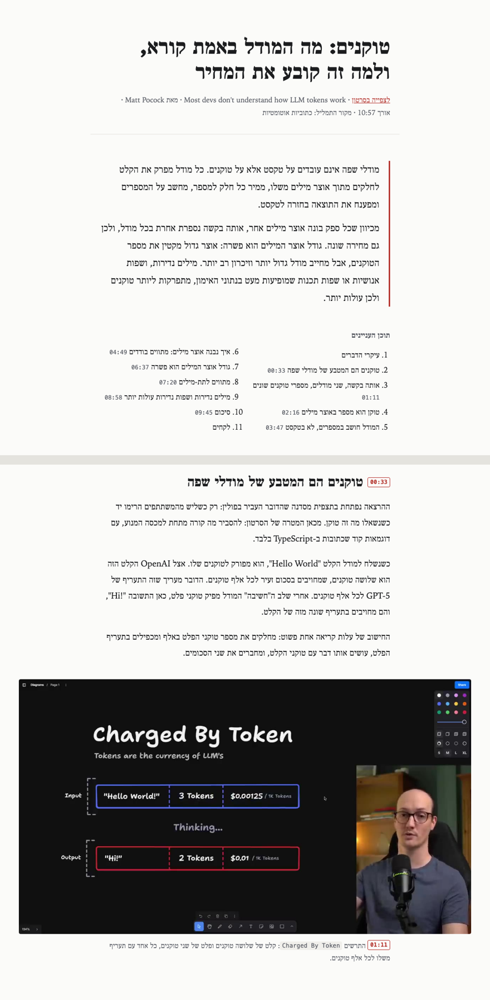

# Visual Video Summarizer

[](https://github.com/yosishe/visual-video-summarizer/actions/workflows/ci.yml)
[](LICENSE)

Turn a lecture, talk or demo into illustrated study notes: a short brief, detailed chapters, the
original slides, code and diagrams beside the text they support, and timestamps that jump back to the
video. One HTML file, Hebrew (right-to-left) by default or English. It is an agent skill: scripts do the
media work, your own agent (Claude Code, Codex) reads and writes. No server, no API key, no upload.



<div dir="rtl">

## מתחילים כאן

1. פותחים את <bdi>Claude Code</bdi> או <bdi>Codex</bdi> בתיקייה שבה רוצים את הסיכום.
2. מדביקים את [הודעת ההתחלה](AGENT-START.txt) ומוסיפים קישור לסרטון, או כותבים פשוט: ״סכם את הסרטון הזה עם תמונות״ והקישור, אם הסקיל כבר מותקן.
3. בסוף מתקבל קובץ <bdi>summary.html</bdi> שנפתח בדפדפן בלי אינטרנט, ולפי בקשה גם <bdi>PDF</bdi>.

עובד עם יוטיוב, עם קישורים ציבוריים אחרים (כולל קובץ ב-<bdi>Google Drive</bdi> ששותף לכל מי שיש לו קישור) ועם הקלטה מהמחשב. כשאין כתוביות, התמלול נעשה במחשב שלך ולא עולה לשום שירות.

</div>

## How it works

```text
prepare  →  transcript.md + frames/F01.jpg… + sheets/sheet-01.jpg…     (scripts)
read     →  the agent reads the transcript and the contact sheets
write    →  notes.md: brief, chapters, [mm:ss] times,  lines   (agent)
render   →  summary.html (+ summary.pdf)                                  (scripts)
```

- **Transcript:** manual captions in the original language first, then automatic captions (never a
  machine translation), then local [whisper.cpp](https://github.com/ggml-org/whisper.cpp). The spoken
  language is detected mid-video, not from a silent intro.
- **Pictures:** a 1-fps scan finds the screens that held still for three seconds and keeps each one's last
  moment (the fully built slide). Blank screens and revisits are dropped, a webcam overlay is ignored,
  and a long stretch with no still screen still gets a picture. Candidates are saved full size and shown
  to the agent as 4×4 contact sheets with the id burned in, so the frame it chooses is the frame you get.
- **Page:** a single file with the images and the font embedded; clickable timestamps; click a picture
  to enlarge it; prints to A4.

## Install

```bash
git clone https://github.com/yosishe/visual-video-summarizer.git ~/.claude/skills/summarize-video
```

For Codex use `~/.agents/skills/summarize-video`. Or clone anywhere and ask the agent to follow
`SKILL.md` from that folder.

Needs Python 3.10+, [Pillow](https://pypi.org/project/pillow/) and ffmpeg; yt-dlp for links:

```bash
brew install ffmpeg yt-dlp pillow
```

`brew install pillow` serves Homebrew's `python3`; for another Python use `python3 -m pip install pillow`.
On Linux or Windows use the package manager, or `pip install pillow yt-dlp`, for the Python that runs the scripts.

For videos without captions (transcribed locally in 10-minute parts; an interrupted run resumes): `brew install whisper-cpp`, download a multilingual model such as
`ggml-large-v3-turbo.bin` from [whisper.cpp's models](https://huggingface.co/ggerganov/whisper.cpp), and set
`VSUM_WHISPER_MODEL` to its path. PDF output uses Chrome, Chromium or Edge if one is installed. Nothing is
installed automatically.

## Use it directly

```bash
python3 scripts/vsum.py prepare "https://www.youtube.com/watch?v=VIDEO_ID"
# write vsum-VIDEO_ID/notes.md (format in SKILL.md)
python3 scripts/vsum.py render vsum-VIDEO_ID --pdf
```

## Privacy

The source platform sees the download. Transcription is local. Your agent's model provider sees the
transcript and the pictures the agent reads, under that provider's terms. Nothing else leaves your
machine. Details: [SECURITY.md](SECURITY.md).

## Development

```bash
python3 -m unittest discover -s tests -v
```

The tests build their own media with ffmpeg and Pillow. Version 1 (a 20,000-line controller with
exit-code gates, kept on `main` history) is described in [CHANGELOG.md](CHANGELOG.md).

## Credits and license

By yosishe, with Claude Code and OpenAI Codex. MIT ([LICENSE](LICENSE)); font notice in [NOTICE](NOTICE).
